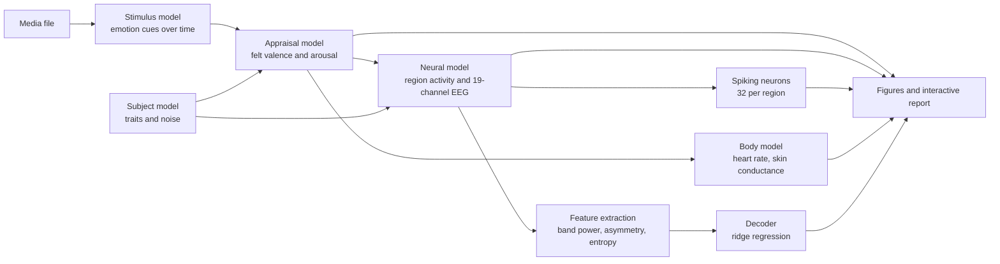

# neuro-sim

Give it a song, video or image and it simulates how a brain would react to it emotionally. You get what the person feels over time, which neurons are firing, the EEG it would produce and even their heart rate. It's a simulation. Nothing is measured from a real person.


*The interactive report 17 seconds into a test video that goes from calm to intense. Everything plays in sync with the media.*

## How it works

1. The media gets broken down into low level cues 10 times a second. Loudness, speed and key for music, colour and motion for images and video.
2. Each cue pushes valence (how pleasant it feels) and arousal (how worked up you are) up or down for a virtual participant with their own traits. The amounts come from published papers.
3. A fake brain turns the feeling into EEG on 19 electrodes, spikes from 32 model neurons per region, heart rate and skin conductance.
4. A decoder reads the emotion back out of the fake EEG, the same way a brain computer interface would with a real one.

Each step is covered properly [further down](#in-detail).

## What is used

- **librosa, PyAV and Pillow** to read the audio, video and images.
- **NumPy and SciPy** for the simulation and the signal processing.
- **scikit-learn** for the decoder, a ridge regression.
- **MNE-Python** to save the EEG in a standard format.
- **Matplotlib** for the figures.

## Run it

Needs Python 3.10 or newer.

```bash
python -m venv .venv && source .venv/bin/activate
pip install -e .

neurosim demo --open                    # makes demo songs, images and a video and reports on each
neurosim run path/to/song.mp3 --open    # put your own song, video or image through it
```

The first run trains the decoder on simulated recordings. Takes about 30 seconds and only happens once. The model is saved to `models/`. Audio and video work in anything FFmpeg can read (MP3, WAV, M4A, FLAC, MP4, MOV and more), and images in the common formats (JPG, PNG, WebP and more).

Useful options for `neurosim run`:

| Option | What it does |
|---|---|
| `--participant N` | Simulate a different virtual person; each number is a new set of traits |
| `--image-seconds S` | How long an image is viewed (default 15) |
| `--out DIR` | Where to write the results (default `outputs/<file name>`) |
| `--open` | Open the interactive report when done |

## What you get

Each run writes a folder of results:

| File | Contents |
|---|---|
| `report.html` | Interactive report that plays the media with every panel synced: a map of firing neurons, emotion space, emotion over time, scrolling EEG, scalp maps, brain regions, stimulus features and body signals. Terminal-style, follows your system's light or dark setting, and works offline. |
| `emotion.png` | Static summary: the features that drove the emotion, felt and decoded valence and arousal, the path through emotion space, and heart rate and skin conductance |
| `brain.png` | Static summary: 10 s of EEG at peak arousal, band-power scalp maps, region activity over time and an electrode × time alpha heatmap |
| `neurons.png` | Every simulated spike: one row per model neuron, grouped by brain region |
| `timeline.csv` | Every time series in the report as a table, including each region's firing rate |
| `simulated_eeg_raw.fif` | The simulated EEG in MNE-Python's format, with the rest and stimulus periods annotated |
| `summary.json` | Media details, the participant's traits and how well the decoder matched the felt emotion |


## In detail



### 1. Emotion representation

Emotion is a point in Russell's (1980) circumplex. Valence runs from unpleasant (−1) to pleasant (+1), and arousal from calm (−1) to excited (+1). Words such as *happy*, *tense*, *sad* and *calm* are read off the circle by angle, and points near the centre are *neutral*.

### 2. Stimulus model

The media is reduced to emotion cues sampled 10 times a second ([`stimulus/`](src/neurosim/stimulus)):

| Media | Cue | How it is measured |
|---|---|---|
| Audio | Loudness | RMS level |
| | Speed | Sound onsets per second |
| | Beat strength | Pulse clarity from the onset tempogram |
| | Major / minor mode | Key finding with Temperley's (1999) profiles, on the harmonic part of the sound (drums separated out) |
| | Timbral brightness | Spectral centroid |
| | Dissonance | Plomp–Levelt roughness between spectral peaks (Sethares, 1993) |
| Images and video | Brightness, saturation, warmth | Pixel statistics |
| | Colourfulness | Hasler & Süsstrunk (2003) metric |
| | Contrast | Spread of brightness |
| Video only | Motion | Frame-to-frame change |
| | Editing pace | Scene cuts per second, from colour-histogram jumps |

A video's soundtrack is analysed as audio too. Sound onsets and scene cuts are also kept as discrete events, because they evoke their own brain responses.

### 3. Subject model

Each virtual participant ([`subject.py`](src/neurosim/subject.py)) is drawn from population distributions, so no two react the same. They get emotional traits (resting mood, reactivity, inertia, taste for each cue), neural traits (alpha frequency and power, frontal asymmetry, noise level, blink rate) and a resting heart rate and skin conductance.

### 4. From stimulus to felt emotion

Each cue pushes valence and arousal with a weight taken from the literature ([`appraisal.py`](src/neurosim/appraisal.py)). In music, major mode raises valence, speed, loudness and a strong beat raise arousal, and dissonance lowers valence while raising arousal (Gabrielsson & Lindström, 2010; Eerola, Friberg & Bresin, 2013; Blood et al., 1999). In images and film, brightness reads as pleasant, and saturation, warm colours, motion and fast editing as arousing (Valdez & Mehrabian, 1994; Detenber, Simons & Bennett, 1998). Anything sudden gives a quick spike in arousal.

The felt emotion follows that target with the person's inertia (an Ornstein–Uhlenbeck process), so feelings build up and fade instead of jumping around. Every run starts with 10 seconds of rest as a baseline.

### 5. From emotion to brain and body signals

Eight cortical regions each put out delta, theta, alpha, beta and gamma waves ([`eeg.py`](src/neurosim/eeg.py)). Arousal suppresses alpha, especially at the back of the head, and boosts beta and gamma (Pfurtscheller & Lopes da Silva, 1999; Klimesch, 1999). Valence shows up as frontal alpha asymmetry, with less alpha on the left when you feel good (Davidson, 1992; Coan & Allen, 2004), plus more temporal beta and gamma (Zheng & Lu, 2015). Sound lights up the auditory cortex and images the visual cortex. Every sound onset or scene cut adds an evoked response on top, along with a late positive potential that grows with arousal (Cuthbert et al., 2000).

The regions are mixed onto 19 scalp electrodes in the 10–20 layout, the same montage as [OpenNeuro ds002721](https://openneuro.org/datasets/ds002721) (Daly et al., 2020), with background activity, sensor noise and eye blinks added. The amygdala/limbic system is tracked but produces no EEG, since it is too deep for scalp electrodes. Heart rate and skin conductance both rise with arousal, heart rate gradually and skin conductance in bursts (Boucsein, 2012) ([`physio.py`](src/neurosim/physio.py)).

### 6. Simulated neurons

Each region also holds 32 model neurons ([`neurons.py`](src/neurosim/neurons.py)). They fire sparsely at rest (2–3 spikes a second, like real cortical neurons) and up to about 20 a second when their region is busy. Auditory neurons also burst at each sound onset and visual neurons at each scene change. Spikes are drawn as a Poisson process.

The report draws them as pyramidal cells in the style of the [MICrONS](https://www.nih.gov/news-events/nih-research-matters/understanding-how-visual-information-processed-brain) reconstructions of mouse visual cortex. The shapes are grown by code, not traced from tissue, and drawn about 15 times life size.


### 7. Reading the emotion back from the EEG

The EEG is cut into 2-second windows every 0.5 s and each window becomes 154 features ([`features.py`](src/neurosim/features.py)): log band power per electrode and band (95), left–right asymmetry for 8 electrode pairs per band (40) and spectral entropy per electrode (19). Features are measured against the person's resting baseline and smoothed over a few seconds, then a ridge regression predicts valence and arousal ([`decoder.py`](src/neurosim/decoder.py)).

Training data comes from the simulation itself: 32 virtual participants each experience 40 synthetic stimuli, a design like the DEAP dataset. Each of the 4 cross-validation folds tests on people **and** stimuli the decoder has never seen.

## Results

| | Valence | Arousal |
|---|---|---|
| Correlation with felt emotion | r = 0.61 | r = 0.72 |
| High vs low correct | 73% (chance 53%) | 81% (chance 74%) |

Scored on held-out people and stimuli. The decoder lands in the right quadrant of the circumplex 59% of the time (chance 39%). As in real EEG studies, arousal is easier to read than valence, and the decoder is cautious, pulling towards neutral when the signal is weak. `neurosim train` retrains it, and `--media-dir` adds your own media files to the training stimuli.


## Project layout

```
src/neurosim/
  stimulus/      media -> emotion cues (audio, images/video, synthetic training stimuli)
  subject.py     virtual participants
  appraisal.py   cues -> felt valence and arousal over time
  brain.py       electrode montage, brain regions, volume conduction, scalp-map interpolation
  eeg.py         region oscillations, evoked responses, background, blinks -> scalp EEG
  physio.py      heart rate and skin conductance
  neurons.py     spiking model neurons in every region
  simulate.py    runs the whole simulation
  features.py    EEG features (band power, asymmetry, spectral entropy)
  decoder.py     training data, cross-validated ridge decoder
  pipeline.py    media file -> simulation -> decoded emotion -> output files
  report/        static figures, interactive HTML report, shared colour palette
  demo.py        synthesised demo music, images and video
  cli.py         neurosim run | train | demo
tests/           pytest suite (python -m pytest)
```

## References

- Blood, A. J., Zatorre, R. J., Bermudez, P., & Evans, A. C. (1999). Emotional responses to pleasant and unpleasant music correlate with activity in paralimbic brain regions. *Nature Neuroscience*, 2(4), 382–387.
- Boucsein, W. (2012). *Electrodermal Activity* (2nd ed.). Springer.
- Coan, J. A., & Allen, J. J. B. (2004). Frontal EEG asymmetry as a moderator and mediator of emotion. *Biological Psychology*, 67(1–2), 7–50.
- Cuthbert, B. N., Schupp, H. T., Bradley, M. M., Birbaumer, N., & Lang, P. J. (2000). Brain potentials in affective picture processing: covariation with autonomic arousal and affective report. *Biological Psychology*, 52(2), 95–111.
- Daly, I., Nicolaou, N., Williams, D., Hwang, F., Kirke, A., Miranda, E., & Nasuto, S. J. (2020). Neural and physiological data from participants listening to affective music. *Scientific Data*, 7, 177.
- Davidson, R. J. (1992). Anterior cerebral asymmetry and the nature of emotion. *Brain and Cognition*, 20(1), 125–151.
- Detenber, B. H., Simons, R. F., & Bennett, G. G. (1998). Roll 'em!: The effects of picture motion on emotional responses. *Journal of Broadcasting & Electronic Media*, 42(1), 113–127.
- Eerola, T., Friberg, A., & Bresin, R. (2013). Emotional expression in music: contribution, linearity, and additivity of primary musical cues. *Frontiers in Psychology*, 4, 487.
- Gabrielsson, A., & Lindström, E. (2010). The role of structure in the musical expression of emotions. In P. N. Juslin & J. A. Sloboda (Eds.), *Handbook of Music and Emotion*. Oxford University Press.
- Hasler, D., & Süsstrunk, S. (2003). Measuring colourfulness in natural images. *Proc. SPIE 5007, Human Vision and Electronic Imaging VIII*.
- Klimesch, W. (1999). EEG alpha and theta oscillations reflect cognitive and memory performance: a review and analysis. *Brain Research Reviews*, 29(2–3), 169–195.
- Krumhansl, C. L. (1990). *Cognitive Foundations of Musical Pitch*. Oxford University Press.
- Pfurtscheller, G., & Lopes da Silva, F. H. (1999). Event-related EEG/MEG synchronization and desynchronization: basic principles. *Clinical Neurophysiology*, 110(11), 1842–1857.
- Plomp, R., & Levelt, W. J. M. (1965). Tonal consonance and critical bandwidth. *Journal of the Acoustical Society of America*, 38(4), 548–560.
- Russell, J. A. (1980). A circumplex model of affect. *Journal of Personality and Social Psychology*, 39(6), 1161–1178.
- Sethares, W. A. (1993). Local consonance and the relationship between timbre and scale. *Journal of the Acoustical Society of America*, 94(3), 1218–1228.
- Temperley, D. (1999). What's key for key? The Krumhansl–Schmuckler key-finding algorithm reconsidered. *Music Perception*, 17(1), 65–100.
- Valdez, P., & Mehrabian, A. (1994). Effects of color on emotions. *Journal of Experimental Psychology: General*, 123(4), 394–409.
- Zheng, W.-L., & Lu, B.-L. (2015). Investigating critical frequency bands and channels for EEG-based emotion recognition with deep neural networks. *IEEE Transactions on Autonomous Mental Development*, 7(3), 162–175.

## License

MIT
